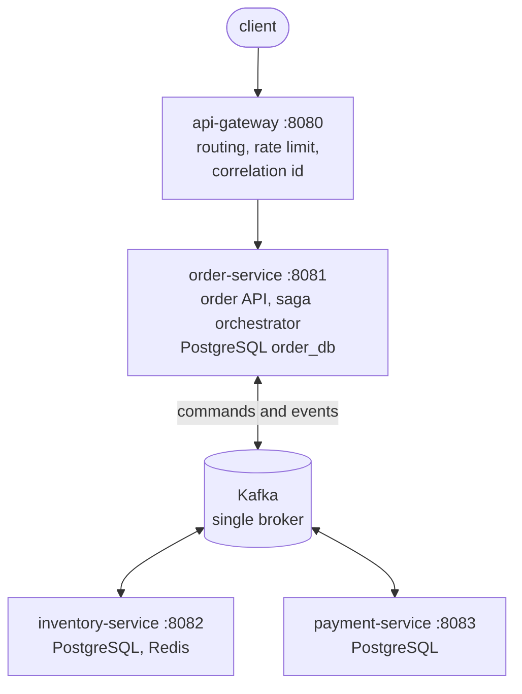

# Ticket Reservation Engine

[](https://github.com/BatuhanBaysal/ticket-reservation-engine/actions/workflows/ci.yml)

A backend for reserving event seats. The goal is that each seat is sold at most once, a repeated payment request charges once, and every order ends in a consistent state across services, including when messages repeat, payments time out, or holds expire.

Stack: Java 21, Spring Boot 4.1, Apache Kafka, PostgreSQL, Redis.

> **Status:** `v0.2.0` in progress, `v0.1.0` released. What exists is listed in the [changelog](CHANGELOG.md). Everything below labeled **Planned** is not built.

---

## What this project proves (Planned)

- **One holder per seat under contention.** One conditional SQL UPDATE decides. Redis only rejects losers early ([ADR-001](docs/adr/ADR-001-seat-hold.md)). Test: 100 concurrent holds, 1 success, with and without Redis.
- **One order per `Idempotency-Key`.** A unique key on the order. Test: the same key twice gives 1 order.
- **One charge per payment request.** A unique `payment_request_id` and a stored result ([ADR-004](docs/adr/ADR-004-payment-timeout.md)). Test: a lost response gives 1 charge.
- **No lost or duplicate side effects.** Transactional outbox and an inbox table ([ADR-003](docs/adr/ADR-003-outbox-and-inbox.md)). Test: the same message twice gives 1 effect.
- **Every failure ends in a clean state.** Orchestrated saga with compensation ([ADR-002](docs/adr/ADR-002-orchestrated-saga.md)). Test: the happy path and 4 compensation paths.

Full test list: [ENGINEERING_STANDARDS.md](docs/ENGINEERING_STANDARDS.md).

---

## Architecture (Planned)



Details, state machines and data model: [ARCHITECTURE.md](docs/ARCHITECTURE.md).

| Module              | Responsibility                                                    |
|:--------------------|:------------------------------------------------------------------|
| `common-events`     | Message envelope, commands and events as Java records, JSON codec |
| `inventory-service` | Seat state, holds, hold expiry                                    |
| `order-service`     | Order API, saga state machine, retries                            |
| `payment-service`   | Simulated payments, idempotent by key                             |
| `api-gateway`       | Routing, rate limit, correlation id, internal secret              |

---

## Status

| Milestone | Scope                                                                                            | Status |
|:----------|:-------------------------------------------------------------------------------------------------|:------:|
| `v0.0.1`  | Foundation: parent POM, docs, ADRs, CI, local infrastructure (Docker Compose), service skeletons |   ✅    |
| `v0.1.0`  | Event and command contracts, serialization tests                                                 |   ✅    |
| `v0.2.0`  | Seat hold, confirm, release, expiry. Concurrency tests                                           |   🚧   |
| `v0.3.0`  | Order API, idempotency key, saga state machine, Kafka command handling, outbox, inbox            |   ⏳    |
| `v0.4.0`  | Idempotent payment, simulator modes, compensation tests                                          |   ⏳    |
| `v0.5.0`  | `api-gateway`: routing, rate limit, internal secret                                              |   ⏳    |
| `v0.6.0`  | Micrometer metrics, load test, `docs/BENCHMARKS.md`                                              |   ⏳    |
| `v1.0.0`  | ER diagram check, demo script, final Known limitations                                           |   ⏳    |

✅ done  🚧 in progress  ⏳ planned

---

## Measured results

None yet. This table is filled from `v0.2.0`.

| Measurement                                    | Result |
|:-----------------------------------------------|:-------|
| 100 concurrent holds, one seat, Redis gate on  | —      |
| 100 concurrent holds, one seat, Redis gate off | —      |
| Tests passing                                  | —      |
| Hold latency p95, gate on vs off               | —      |

---

## Tech stack

| Layer     | Tool                                       | Reason                                                  |
|:----------|:-------------------------------------------|:--------------------------------------------------------|
| Language  | Java 21                                    | Records for message types                               |
| Framework | Spring Boot 4.1                            | Boot 3.x has no OSS support after June 2026             |
| Messaging | Apache Kafka (KRaft)                       | Commands and events between services                    |
| Database  | PostgreSQL, Liquibase                      | One database per service, schema through migrations     |
| Cache     | Redis, Spring Data Redis                   | Seat hold gate, gateway rate limit                      |
| Gateway   | Spring Cloud Gateway (Spring Cloud 2025.1) | Routing and rate limit                                  |
| Testing   | JUnit, Testcontainers                      | Integration tests against real PostgreSQL, Redis, Kafka |
| Coverage  | JaCoCo                                     | Report only, no percentage gate                         |

---

## Known limitations

- No authentication. The customer id is a request header.
- `payment-service` is a simulator. There is no real payment provider and no reconciliation job.
- One Kafka broker, one Redis, one PostgreSQL container with three databases. No failover.
- The hold time is one value for all seats (default 10 minutes).
- No frontend and no notification service in `v1.0.0` ([ADR-005](docs/adr/ADR-005-scope-and-platform.md)).
- Local only. No cloud deployment.

---

## Local setup

### Requirements

Java 21, Maven 3.9 and Docker. The tests start PostgreSQL, Redis and Kafka with Testcontainers, so Docker must be running when you run `mvn clean verify`.

### Build and start the infrastructure

```bash
git clone https://github.com/BatuhanBaysal/ticket-reservation-engine.git
cd ticket-reservation-engine
cp .env.example .env

mvn clean verify

docker compose --env-file .env \
  -f infra/docker-compose.yml up -d
docker compose --env-file .env \
  -f infra/docker-compose.yml ps
```

PostgreSQL listens on `POSTGRES_PORT`, Kafka on `9092`, Redis on `REDIS_PORT`. If a port is already in use, change it in `.env`.

### Run the services

Start each service in its own terminal with the `local` profile, which reads `.env`:

```bash
mvn -DskipTests install
mvn -pl order-service spring-boot:run \
  -Dspring-boot.run.profiles=local
mvn -pl inventory-service spring-boot:run \
  -Dspring-boot.run.profiles=local
mvn -pl payment-service spring-boot:run \
  -Dspring-boot.run.profiles=local
```

Health endpoints:

- order-service: `http://localhost:8081/actuator/health`
- inventory-service: `http://localhost:8082/actuator/health`
- payment-service: `http://localhost:8083/actuator/health`

### Stop

```bash
docker compose --env-file .env \
  -f infra/docker-compose.yml down
```

Add `-v` to delete the PostgreSQL data. The init script that creates the three databases runs only on the first start with an empty volume.

---

## License

MIT License. See [LICENSE](LICENSE).
