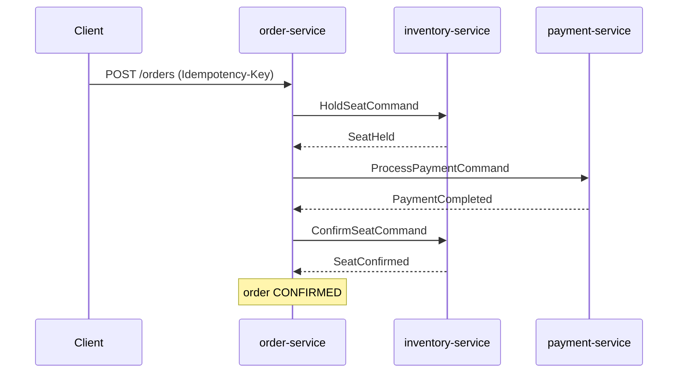
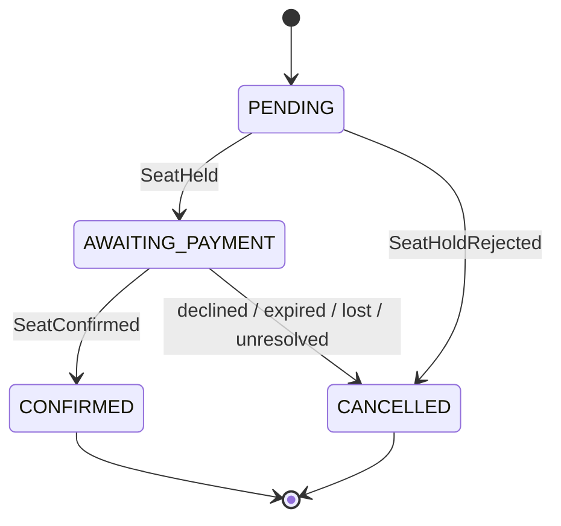
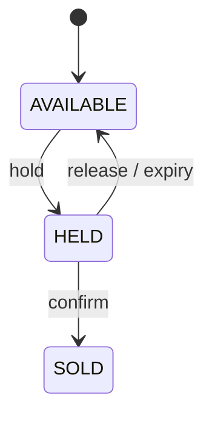
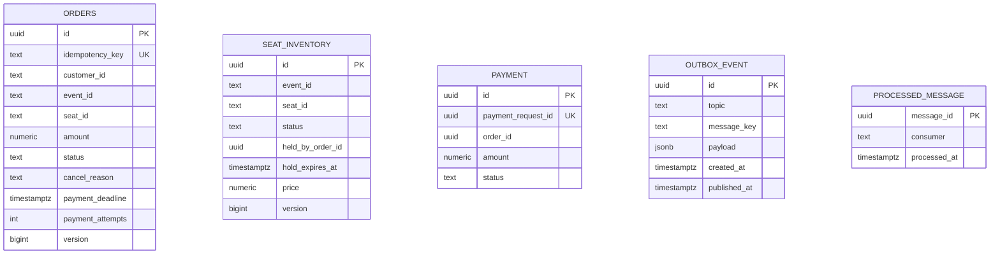
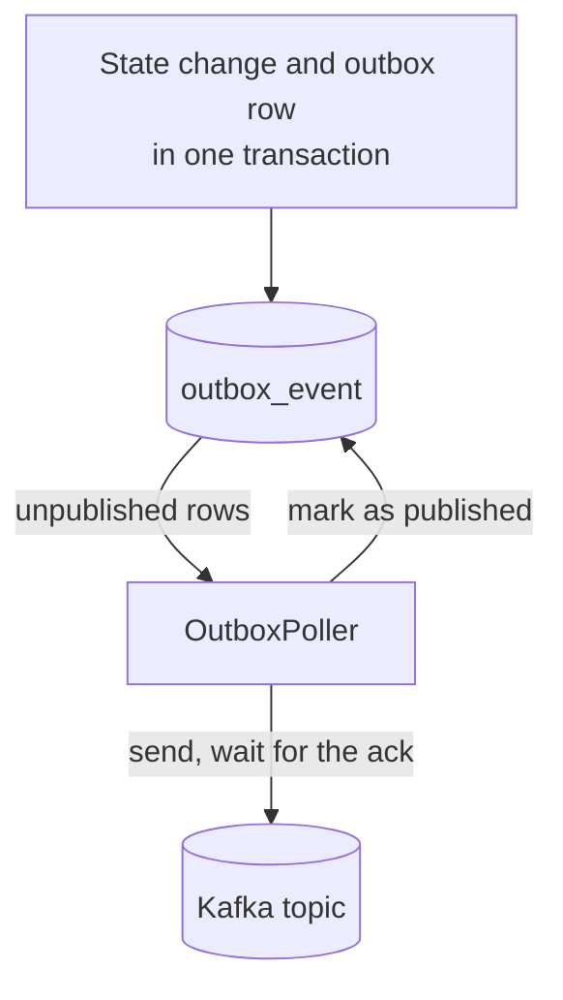

# Architecture

Status: the message contracts, the seat table and the seat rules describe code that exists. Everything else is **Planned**, except where a decision record is linked.

## Services

| Module              | Responsibility                                                                   | Data                             |
|:--------------------|:---------------------------------------------------------------------------------|:---------------------------------|
| `common-events`     | Message envelope, event and command records (Java `record`) and the JSON codec.  | none                             |
| `inventory-service` | Seat state, holds, confirm, release, expiry. [ADR-001](adr/ADR-001-seat-hold.md) | PostgreSQL `inventory_db`, Redis |
| `order-service`     | Order API, saga orchestration. [ADR-002](adr/ADR-002-orchestrated-saga.md)       | PostgreSQL `order_db`            |
| `payment-service`   | Simulated payments, idempotent by key. [ADR-004](adr/ADR-004-payment-timeout.md) | PostgreSQL `payment_db`          |
| `api-gateway`       | Routing, rate limit, correlation id, internal secret.                            | Redis                            |

Every service that publishes messages has an outbox and an inbox ([ADR-003](adr/ADR-003-outbox-and-inbox.md)).

## Flow

Compensation paths (details in ADR-002 and ADR-004):

| Trigger                                  | Result                                                        |
|:-----------------------------------------|:--------------------------------------------------------------|
| `SeatHoldRejected`                       | `CANCELLED(SEAT_UNAVAILABLE)`                                 |
| `PaymentDeclined`                        | release seat, `CANCELLED(PAYMENT_DECLINED)`                   |
| `SeatHoldExpired` while awaiting payment | cancel payment, `CANCELLED(HOLD_EXPIRED)`                     |
| `SeatConfirmFailed`                      | refund, `CANCELLED(SEAT_LOST)`                                |
| No payment reply after 3 attempts        | release seat, cancel payment, `CANCELLED(PAYMENT_UNRESOLVED)` |

Saga steps by milestone ([ADR-002](adr/ADR-002-orchestrated-saga.md)):

- **Planned** for `v0.3.0`: the happy path, `SeatHoldRejected` and `PaymentDeclined` (steps 1, 2, 2a, 3, 3a and 4).
- **Planned** for `v0.4.0`: the payment deadline job (3b), `SeatConfirmFailed` (4a), `SeatHoldExpired` (5) and the rule for a late `PaymentCompleted`.

## State machines

## Message contracts

Every message is the payload of the envelope (ADR-003) and is written as JSON ([ADR-006](adr/ADR-006-message-wire-format.md)). The records live in `common-events`, the topic names in `Topics` and the type names in `MessageTypes`.

### Inventory messages

Topic `inventory.commands`, sent by order-service, read by inventory-service:

| Message              | Fields                         |
|:---------------------|:-------------------------------|
| `HoldSeatCommand`    | `orderId`, `eventId`, `seatId` |
| `ConfirmSeatCommand` | `orderId`, `eventId`, `seatId` |
| `ReleaseSeatCommand` | `orderId`, `eventId`, `seatId` |

Topic `inventory.events`, sent by inventory-service, read by order-service:

| Message             | Fields                                                   |
|:--------------------|:---------------------------------------------------------|
| `SeatHeld`          | `orderId`, `eventId`, `seatId`, `price`, `holdExpiresAt` |
| `SeatHoldRejected`  | `orderId`, `eventId`, `seatId`, `reason`                 |
| `SeatConfirmed`     | `orderId`, `eventId`, `seatId`                           |
| `SeatConfirmFailed` | `orderId`, `eventId`, `seatId`, `reason`                 |
| `SeatHoldExpired`   | `orderId`, `eventId`, `seatId`                           |

Field types: `orderId` is a UUID. `eventId`, `seatId` and `reason` are text. `price` is a decimal amount greater than zero. `holdExpiresAt` is a UTC timestamp. No field may be null and text fields must not be blank.

`SeatHeld` carries the price because order-service needs the amount for `ProcessPaymentCommand` (ADR-002, step 2).

Reason codes are text, not enums, so a new code does not break an old consumer:

| Message             | Codes                                |
|:--------------------|:-------------------------------------|
| `SeatHoldRejected`  | `SEAT_UNAVAILABLE`, `SEAT_NOT_FOUND` |
| `SeatConfirmFailed` | `HOLD_NOT_FOUND`, `SEAT_TAKEN`       |

### Payment messages

Topic `payment.commands`, sent by order-service, read by payment-service:

| Message                 | Fields                                  |
|:------------------------|:----------------------------------------|
| `ProcessPaymentCommand` | `paymentRequestId`, `orderId`, `amount` |
| `CancelPaymentCommand`  | `paymentRequestId`, `orderId`           |

Topic `payment.events`, sent by payment-service, read by order-service:

| Message            | Fields                                   |
|:-------------------|:-----------------------------------------|
| `PaymentCompleted` | `paymentRequestId`, `orderId`, `amount`  |
| `PaymentDeclined`  | `paymentRequestId`, `orderId`, `reason`  |
| `PaymentCancelled` | `paymentRequestId`, `orderId`, `outcome` |

Field types: `paymentRequestId` and `orderId` are UUIDs. `amount` is a decimal amount greater than zero. `reason` and `outcome` are text. No field may be null and text fields must not be blank.

In the saga, `paymentRequestId` equals the order id (ADR-002, step 2). payment-service stores and looks up requests by `paymentRequestId` only (ADR-004).

`outcome` of `PaymentCancelled` is a text code, not an enum:

| Code        | Meaning                                                     |
|:------------|:------------------------------------------------------------|
| `REFUNDED`  | The payment had been charged and was refunded               |
| `CANCELLED` | No charge existed. A later charge with this key is rejected |

### Codec

`MessageCodec` in `common-events` writes an envelope as JSON and reads it back. On reading it takes the payload class from `type`. Instants are ISO-8601 text and amounts are decimal strings. Fields the record does not have are ignored.

| Case                                                                                                | Result                        |
|:----------------------------------------------------------------------------------------------------|:------------------------------|
| `type` is not registered                                                                            | `UnknownMessageTypeException` |
| Malformed JSON, a missing envelope or payload field, or a value that breaks the rules of its record | `InvalidMessageException`     |
| On writing, the payload class does not match `type`                                                 | `InvalidMessageException`     |

### Contract tests

Every message type has a sample message in the tests of `common-events` and a stored JSON file in `src/test/resources/contracts/<Type>.json`. The tests check three things: the codec writes the stored JSON, it reads the stored JSON back into the sample, and a round trip returns the same message. A change of a field name or format fails these tests, and the stored file changes in the same pull request ([ADR-006](adr/ADR-006-message-wire-format.md)).

## Data model

Money columns use `NUMERIC(19, 4)` and `BigDecimal` in code. Timestamps are `timestamptz`.

### Overview

`SEAT_INVENTORY`, `OUTBOX_EVENT` and `PROCESSED_MESSAGE` exist today, in `inventory_db`. The other tables are **Planned**.

`OUTBOX_EVENT` and `PROCESSED_MESSAGE` exist in each of the three databases. The three databases are separate. The diagram shows them together for reading only.

### Indexes

The reason for each index is recorded next to its Liquibase changeset.

- `seat_inventory (hold_expires_at) WHERE status = 'HELD'`: the expiry job reads only held rows.
- `orders (payment_deadline) WHERE status = 'AWAITING_PAYMENT'`: the retry job reads only these rows.
- `outbox_event (created_at) WHERE published_at IS NULL`: the poller reads only unpublished rows.

### Seat table

`seat_inventory` in `inventory_db` ([ADR-001](adr/ADR-001-seat-hold.md)), created by the Liquibase changeset `001-seat-inventory`.

| Column             | Type            | Rule                                   |
|:-------------------|:----------------|:---------------------------------------|
| `id`               | `uuid`          | primary key                            |
| `event_id`         | `varchar(64)`   | not null, `UNIQUE (event_id, seat_id)` |
| `seat_id`          | `varchar(64)`   | not null                               |
| `status`           | `varchar(16)`   | `AVAILABLE`, `HELD` or `SOLD`          |
| `held_by_order_id` | `uuid`          | see below                              |
| `hold_expires_at`  | `timestamptz`   | see below                              |
| `price`            | `numeric(19,4)` | greater than zero                      |
| `version`          | `bigint`        | optimistic lock, starts at 0           |

The status decides which of the two nullable columns are filled. One check constraint enforces it, so the database cannot hold an invalid state. A status that is not one of the three matches none of the rows below and is rejected too.

| Status      | `held_by_order_id` | `hold_expires_at` |
|:------------|:-------------------|:------------------|
| `AVAILABLE` | null               | null              |
| `HELD`      | set                | set               |
| `SOLD`      | set                | null              |

The database clock (`now()`) decides every hold and every expiry. The partial index `idx_seat_inventory_held_expiry` is described under Indexes.

### Outbox table

`outbox_event` in `inventory_db`, created by the changeset `002-outbox-event` ([ADR-003](adr/ADR-003-outbox-and-inbox.md)). The other services get the same table when they get an outbox.

| Column         | Type           | Rule                           |
|:---------------|:---------------|:-------------------------------|
| `id`           | `uuid`         | primary key                    |
| `topic`        | `varchar(128)` | not null                       |
| `message_key`  | `varchar(128)` | not null, the order id         |
| `payload`      | `jsonb`        | not null, the envelope as JSON |
| `created_at`   | `timestamptz`  | not null, set by the database  |
| `published_at` | `timestamptz`  | null until the message is sent |

`OutboxWriter` writes a row. It needs a transaction and throws without one, so a row exists only when the state change commits. The partial index `idx_outbox_event_unpublished` is described under Indexes.

### Inbox table

`processed_message` in `inventory_db`, created by the changeset `003-processed-message` ([ADR-003](adr/ADR-003-outbox-and-inbox.md)). The other services get the same table when they get an inbox.

| Column         | Type           | Rule                          |
|:---------------|:---------------|:------------------------------|
| `message_id`   | `uuid`         | primary key                   |
| `consumer`     | `varchar(128)` | not null, the consumer group  |
| `processed_at` | `timestamptz`  | not null, set by the database |

`InboxGuard` inserts the message id with `ON CONFLICT DO NOTHING`. One inserted row means the first delivery. It needs a transaction and throws without one, so the row exists only when the handler commits.

## Seat rules

### Hold

`SeatService.hold` in `inventory-service` returns `Held` (price and expiry) or `Rejected` with the reason `SEAT_UNAVAILABLE` or `SEAT_NOT_FOUND` ([ADR-001](adr/ADR-001-seat-hold.md)). One conditional update in PostgreSQL decides. It uses the database clock, and the hold lasts `inventory.hold.duration` (default 10 minutes).

| Seat when the order asks              | Result                                                     |
|:--------------------------------------|:-----------------------------------------------------------|
| `AVAILABLE`                           | `Held`. The seat becomes `HELD` for the order              |
| `HELD`, hold expired                  | `Held`. The seat passes to the asking order                |
| `HELD` by the same order, not expired | `Held` with the existing price and expiry. Nothing changes |
| `HELD` by another order, not expired  | `Rejected(SEAT_UNAVAILABLE)`                               |
| `SOLD`                                | `Rejected(SEAT_UNAVAILABLE)`                               |
| not found                             | `Rejected(SEAT_NOT_FOUND)`                                 |

A seat that becomes available between the update and the read is reported as `SEAT_UNAVAILABLE`. The order can ask again.

### Redis gate

Before the database update, `RedisHoldGate` tells the hold to proceed or to stop ([ADR-001](adr/ADR-001-seat-hold.md)). The gate only saves database calls. The database still decides.

| Situation                           | Decision                                         |
|:------------------------------------|:-------------------------------------------------|
| no key for the seat                 | set the key, proceed                             |
| key with the same order's id        | proceed                                          |
| key with another order's id         | reject with `SEAT_UNAVAILABLE`, no database call |
| Redis fails or times out            | skip the gate, log a warning, proceed            |
| `inventory.hold.gate.enabled=false` | skip the gate, proceed                           |

The key is `hold:{eventId}:{seatId}`. Its value is the order id and its TTL is the hold duration. When the database rejects a hold, the gate deletes the key only if its value is the order's own id.

Redis commands time out after 500 ms. `SeatService.hold` keeps no database transaction open while it waits for Redis.

### Confirm

`SeatService.confirm` returns `Confirmed` or `Failed` with the reason `HOLD_NOT_FOUND` or `SEAT_TAKEN` ([ADR-001](adr/ADR-001-seat-hold.md)).

| Seat when the order confirms        | Result                                                      |
|:------------------------------------|:------------------------------------------------------------|
| `HELD` by the order, expired or not | `Confirmed`. The seat becomes `SOLD`, the expiry is cleared |
| `SOLD` to the order                 | `Confirmed`. Nothing changes                                |
| `HELD` or `SOLD` by another order   | `Failed(SEAT_TAKEN)`                                        |
| `AVAILABLE`                         | `Failed(HOLD_NOT_FOUND)`                                    |
| not found                           | `Failed(HOLD_NOT_FOUND)`                                    |

A hold that has expired but was not released yet can still be confirmed. A paid order keeps its seat unless someone else took it (ADR-002, step 4a).

### Release

`SeatService.release` returns nothing.

| Seat when the order releases | Result                                                     |
|:-----------------------------|:-----------------------------------------------------------|
| `HELD` by the order          | The seat becomes `AVAILABLE`. Order and expiry are cleared |
| any other state or not found | Nothing changes                                            |

After the database step, the gate deletes the Redis key of the order, only when its value is the order's own id.

### Repeated requests

Hold, confirm and release are safe to repeat. A second request of the same order returns the same result and changes nothing, also when both requests arrive at the same moment. The seat version goes up once per change, not once per request.

**Planned:** the inbox that drops a repeated message before it reaches these operations comes with the Kafka command handling in `v0.3.0` ([ADR-003](adr/ADR-003-outbox-and-inbox.md)).

### Concurrent changes

Confirm and release load the seat and save it with the version check. When another change got there first, for example a new hold or the expiry job, the save fails. The operation starts again in a new transaction and sees the new state, so the rules above apply to it. After 3 attempts it throws `SeatConflictException` and the seat is unchanged.

### Transactions

`SeatSteps` holds the database part of hold, confirm and release. A step requires an open transaction and does not retry. `SeatService` opens a new transaction for each attempt with `TransactionAttempts` and tries at most 3 times on a version conflict.

The Redis gate stays outside of the transaction. A hold asks the gate before the transaction. A release tells the gate after the commit.

`SeatCommandHandler` uses the same steps inside its own transaction, together with the inbox row and the outbox row (see Command handler).

### Expiry

`SeatService.expireOverdueHolds` returns the holds it expired: order id, event id and seat id ([ADR-001](adr/ADR-001-seat-hold.md)). `HoldExpiryJob` runs it every `inventory.hold.expiry.interval` (default 30 s) and logs how many holds expired. `inventory.hold.expiry.enabled=false` turns the job off.

| Seat when the job runs | Result                                                     |
|:-----------------------|:-----------------------------------------------------------|
| `HELD`, hold expired   | `AVAILABLE`. Order and expiry are cleared, version + 1     |
| `HELD`, not expired    | Unchanged                                                  |
| `SOLD` or `AVAILABLE`  | Unchanged                                                  |

One statement does the work and uses the index of held seats. Two runs at the same time never expire the same hold twice. A seat with an expired hold can already be held by another order before the job runs. The Redis key needs no delete: it expires with the hold.

Each expired hold also writes a `SeatHoldExpired` event to the outbox, in the same transaction as the update ([ADR-003](adr/ADR-003-outbox-and-inbox.md)). The topic is `inventory.events`, the key is the order id and every event gets a new correlation id. When the transaction rolls back, the seat change and the rows roll back together.

The outbox poller sends the rows to Kafka (see Outbox flow).

### Confirm and expiry at the same time

A confirm and the expiry job can reach the same seat at the same moment. Exactly one of them wins:

| Winner  | Seat afterwards   | Confirm returns          |
|:--------|:------------------|:-------------------------|
| confirm | `SOLD`, no expiry | `Confirmed`              |
| the job | `AVAILABLE`       | `Failed(HOLD_NOT_FOUND)` |

When the job commits between the load and the save of the confirm, the save fails on the version. The confirm starts again, sees `AVAILABLE` and returns `Failed(HOLD_NOT_FOUND)`. A seat is never `SOLD` with an expiry: the check constraint of the seat table rejects it.

## Outbox flow

A service writes a message as a row of `outbox_event`, in the transaction of the state change. A poller sends the rows to Kafka afterwards ([ADR-003](adr/ADR-003-outbox-and-inbox.md), [ADR-008](adr/ADR-008-messaging-infrastructure.md)). Today only inventory-service has this flow.

The poller runs every 500 ms in one transaction:

1. It selects up to 100 unpublished rows with `FOR UPDATE SKIP LOCKED`, ordered by `created_at`.
2. It sends each row in that order and waits up to 10 seconds for the acknowledgement.
3. It marks the acknowledged rows as published and commits.

When a send fails, the poller stops. The rows that were acknowledged are marked as published. The failed row and the rows after it stay unpublished and the next run starts with them, so the order of the messages for one key is kept. A crash between a send and the commit can send a row twice. The inbox of the consumer drops the repeat.

Two pollers at the same time never take the same row, because locked rows are skipped. The project runs one instance of each service, so the order per key holds.

A cleanup deletes published rows older than 7 days, once an hour. It never deletes an unpublished row.

| Setting                                | Default | Meaning                       |
|:---------------------------------------|:--------|:------------------------------|
| `inventory.outbox.poller.enabled`      | `true`  | Run the poller                |
| `inventory.outbox.poller.interval`     | `500ms` | Wait between two runs         |
| `inventory.outbox.poller.send-timeout` | `10s`   | Wait for one acknowledgement  |
| `inventory.outbox.cleanup.enabled`     | `true`  | Run the cleanup               |
| `inventory.outbox.cleanup.interval`    | `1h`    | Wait between two runs         |
| `inventory.outbox.cleanup.retention`   | `7d`    | Age of the rows that go       |

The producer uses `acks=all` and idempotence. A broker that is down delays a run by a few seconds and loses no row: `max.block.ms` is 5 s, the request timeout 10 s and the delivery timeout 15 s. The topic `inventory.events` has 3 partitions. The `test` profile turns off the jobs and the creation of topics.

## Command handler

`SeatCommandHandler.handle` turns an inventory command into a seat change and an event ([ADR-008](adr/ADR-008-messaging-infrastructure.md)). **Planned:** the Kafka listener that calls it, in `v0.3.0`.

| Command              | Seat change | Event                                  |
|:---------------------|:------------|:---------------------------------------|
| `HoldSeatCommand`    | hold        | `SeatHeld` or `SeatHoldRejected`       |
| `ConfirmSeatCommand` | confirm     | `SeatConfirmed` or `SeatConfirmFailed` |
| `ReleaseSeatCommand` | release     | none                                   |

Each attempt is one transaction: the inbox insert, the seat step and the outbox row. A message whose id is in the inbox is a repeat. A repeat writes nothing and changes no seat. A version conflict rolls back the whole attempt, the inbox row included, and the attempt starts again, at most 3 times.

The events keep the correlation id of the command. Their key is the order id and their topic is `inventory.events`. A payload that inventory does not handle throws `UnsupportedMessageException` before any database work.

For a hold, the handler asks the Redis gate before the transaction. When the gate rejects, the handler writes `SeatHoldRejected(SEAT_UNAVAILABLE)` and changes no seat. The handler releases the gate key of the order after the transaction when the hold was not granted, when the message was a repeat and when the handler fails. A release command releases the key after the commit.

## Decision records

| ADR                                            | Decision                                                           |
|:-----------------------------------------------|:-------------------------------------------------------------------|
| [001](adr/ADR-001-seat-hold.md)                | PostgreSQL decides who holds a seat. Redis is a gate.              |
| [002](adr/ADR-002-orchestrated-saga.md)        | order-service orchestrates the saga.                               |
| [003](adr/ADR-003-outbox-and-inbox.md)         | Outbox for publishing, inbox for repeats.                          |
| [004](adr/ADR-004-payment-timeout.md)          | A timeout is an unknown outcome. Retry with the same key.          |
| [005](adr/ADR-005-scope-and-platform.md)       | Boot 4.1, five modules, what is out of scope.                      |
| [006](adr/ADR-006-message-wire-format.md)      | Messages are JSON text with a `type` field. Fields are only added. |
| [007](adr/ADR-007-order-api.md)                | `POST /orders` answers 202. The same key returns the same order.   |
| [008](adr/ADR-008-messaging-infrastructure.md) | One outbox and inbox copy per service. Failures go to `.dlt`.      |
