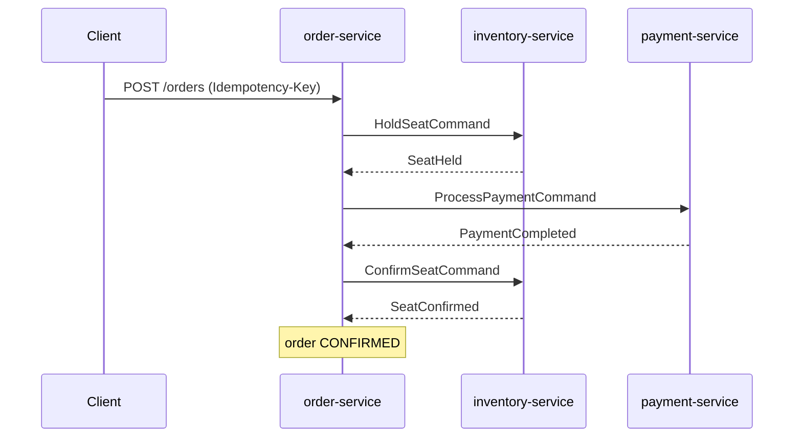
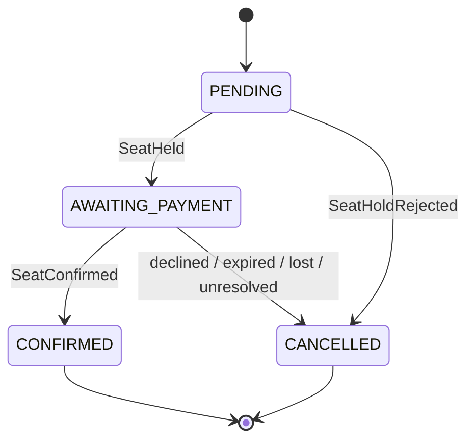
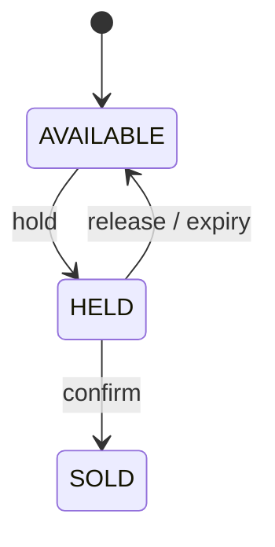
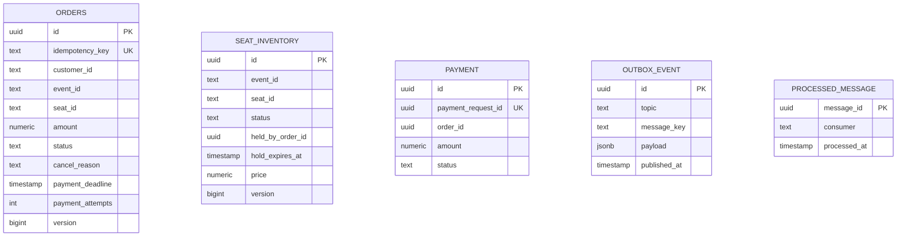

# Architecture

Status: design. The `common-events` module (envelope, topic and type names, inventory and payment messages, JSON codec with contract tests) and skeletons of `inventory-service`, `order-service` and `payment-service` exist. Everything else below is **Planned**, except where a decision record is linked.

## Services

| Module              | Responsibility                                                                   | Data                             |
|:--------------------|:---------------------------------------------------------------------------------|:---------------------------------|
| `common-events`     | Message envelope, event and command records (Java `record`) and the JSON codec.  | none                             |
| `inventory-service` | Seat state, holds, expiry. [ADR-001](adr/ADR-001-seat-hold.md)                   | PostgreSQL `inventory_db`, Redis |
| `order-service`     | Order API, saga orchestration. [ADR-002](adr/ADR-002-orchestrated-saga.md)       | PostgreSQL `order_db`            |
| `payment-service`   | Simulated payments, idempotent by key. [ADR-004](adr/ADR-004-payment-timeout.md) | PostgreSQL `payment_db`          |
| `api-gateway`       | Routing, rate limit, correlation id, internal secret.                            | Redis                            |

Every service that publishes messages has an outbox and an inbox ([ADR-003](adr/ADR-003-outbox-and-inbox.md)).

## Flow

Compensation paths (details in ADR-002 and ADR-004):

| Trigger                                  | Result                                                        |
|:-----------------------------------------|:--------------------------------------------------------------|
| `SeatHoldRejected`                       | `CANCELLED(SEAT_UNAVAILABLE)`                                 |
| `PaymentDeclined`                        | release seat, `CANCELLED(PAYMENT_DECLINED)`                   |
| `SeatHoldExpired` while awaiting payment | cancel payment, `CANCELLED(HOLD_EXPIRED)`                     |
| `SeatConfirmFailed`                      | refund, `CANCELLED(SEAT_LOST)`                                |
| No payment reply after 3 attempts        | release seat, cancel payment, `CANCELLED(PAYMENT_UNRESOLVED)` |

## State machines

## Message contracts

Every message is the payload of the envelope (ADR-003) and is written as JSON ([ADR-006](adr/ADR-006-message-wire-format.md)). The records live in `common-events`, the topic names in `Topics` and the type names in `MessageTypes`.

### Inventory messages

Topic `inventory.commands`, sent by order-service, read by inventory-service:

| Message              | Fields                         |
|:---------------------|:-------------------------------|
| `HoldSeatCommand`    | `orderId`, `eventId`, `seatId` |
| `ConfirmSeatCommand` | `orderId`, `eventId`, `seatId` |
| `ReleaseSeatCommand` | `orderId`, `eventId`, `seatId` |

Topic `inventory.events`, sent by inventory-service, read by order-service:

| Message             | Fields                                                   |
|:--------------------|:---------------------------------------------------------|
| `SeatHeld`          | `orderId`, `eventId`, `seatId`, `price`, `holdExpiresAt` |
| `SeatHoldRejected`  | `orderId`, `eventId`, `seatId`, `reason`                 |
| `SeatConfirmed`     | `orderId`, `eventId`, `seatId`                           |
| `SeatConfirmFailed` | `orderId`, `eventId`, `seatId`, `reason`                 |
| `SeatHoldExpired`   | `orderId`, `eventId`, `seatId`                           |

Field types: `orderId` is a UUID. `eventId`, `seatId` and `reason` are text. `price` is a decimal amount greater than zero. `holdExpiresAt` is a UTC timestamp. No field may be null and text fields must not be blank.

`SeatHeld` carries the price because order-service needs the amount for `ProcessPaymentCommand` (ADR-002, step 2).

Reason codes are text, not enums, so a new code does not break an old consumer:

| Message             | Codes                                |
|:--------------------|:-------------------------------------|
| `SeatHoldRejected`  | `SEAT_UNAVAILABLE`, `SEAT_NOT_FOUND` |
| `SeatConfirmFailed` | `HOLD_NOT_FOUND`, `SEAT_TAKEN`       |

### Payment messages

Topic `payment.commands`, sent by order-service, read by payment-service:

| Message                 | Fields                                  |
|:------------------------|:----------------------------------------|
| `ProcessPaymentCommand` | `paymentRequestId`, `orderId`, `amount` |
| `CancelPaymentCommand`  | `paymentRequestId`, `orderId`           |

Topic `payment.events`, sent by payment-service, read by order-service:

| Message            | Fields                                   |
|:-------------------|:-----------------------------------------|
| `PaymentCompleted` | `paymentRequestId`, `orderId`, `amount`  |
| `PaymentDeclined`  | `paymentRequestId`, `orderId`, `reason`  |
| `PaymentCancelled` | `paymentRequestId`, `orderId`, `outcome` |

Field types: `paymentRequestId` and `orderId` are UUIDs. `amount` is a decimal amount greater than zero. `reason` and `outcome` are text. No field may be null and text fields must not be blank.

In the saga, `paymentRequestId` equals the order id (ADR-002, step 2). payment-service stores and looks up requests by `paymentRequestId` only (ADR-004).

`outcome` of `PaymentCancelled` is a text code, not an enum:

| Code        | Meaning                                                     |
|:------------|:------------------------------------------------------------|
| `REFUNDED`  | The payment had been charged and was refunded               |
| `CANCELLED` | No charge existed. A later charge with this key is rejected |

### Codec

`MessageCodec` in `common-events` writes an envelope as JSON and reads it back. On reading it takes the payload class from `type`. Instants are ISO-8601 text and amounts are decimal strings. Fields the record does not have are ignored.

| Case                                                                                                | Result                        |
|:----------------------------------------------------------------------------------------------------|:------------------------------|
| `type` is not registered                                                                            | `UnknownMessageTypeException` |
| Malformed JSON, a missing envelope or payload field, or a value that breaks the rules of its record | `InvalidMessageException`     |
| On writing, the payload class does not match `type`                                                 | `InvalidMessageException`     |

### Contract tests

Every message type has a sample message in the tests of `common-events` and a stored JSON file in `src/test/resources/contracts/<Type>.json`. The tests check three things: the codec writes the stored JSON, it reads the stored JSON back into the sample, and a round trip returns the same message. A change of a field name or format fails these tests, and the stored file changes in the same pull request ([ADR-006](adr/ADR-006-message-wire-format.md)).

## Data model

Money columns use `NUMERIC(19, 4)` and `BigDecimal` in code.

`SEAT_INVENTORY` has `UNIQUE (event_id, seat_id)`. `OUTBOX_EVENT` and `PROCESSED_MESSAGE` exist in each of the three databases. The three databases are separate. The diagram shows them together for reading only.

Index notes (the "why" is recorded next to each Liquibase changeset):
- `seat_inventory (hold_expires_at) WHERE status = 'HELD'`: the expiry job reads only held rows.
- `orders (payment_deadline) WHERE status = 'AWAITING_PAYMENT'`: the retry job reads only these rows.
- `outbox_event (created_at) WHERE published_at IS NULL`: the poller reads only unpublished rows.

## Decision records

| ADR                                       | Decision                                                           |
|:------------------------------------------|:-------------------------------------------------------------------|
| [001](adr/ADR-001-seat-hold.md)           | PostgreSQL decides who holds a seat. Redis is a gate.              |
| [002](adr/ADR-002-orchestrated-saga.md)   | order-service orchestrates the saga.                               |
| [003](adr/ADR-003-outbox-and-inbox.md)    | Outbox for publishing, inbox for repeats.                          |
| [004](adr/ADR-004-payment-timeout.md)     | A timeout is an unknown outcome. Retry with the same key.          |
| [005](adr/ADR-005-scope-and-platform.md)  | Boot 4.1, five modules, what is out of scope.                      |
| [006](adr/ADR-006-message-wire-format.md) | Messages are JSON text with a `type` field. Fields are only added. |
